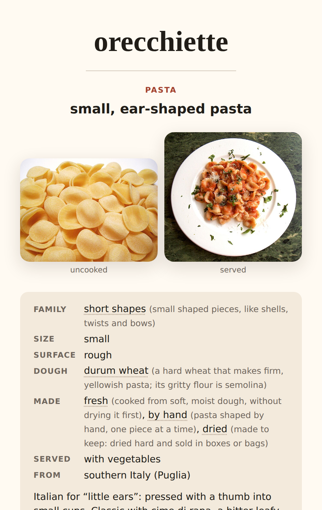
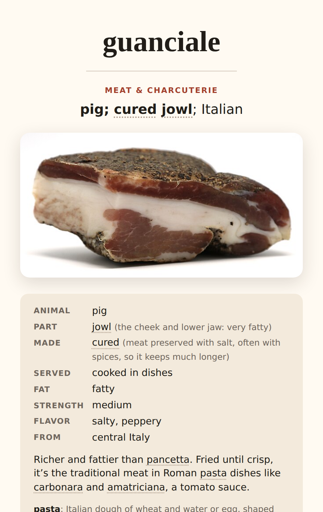
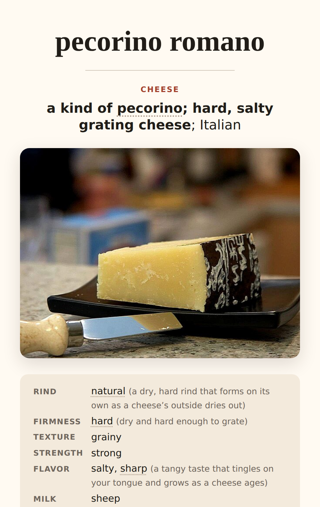
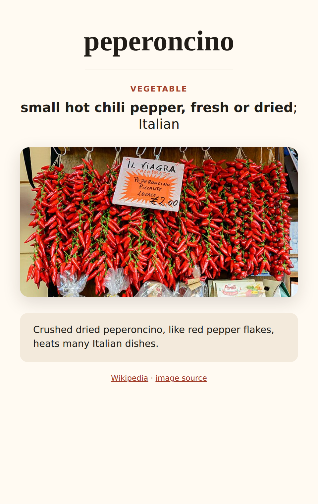

# Menu Foods Anki deck

I've often had trouble with restaurant menus. Is this foreign-language word a meat, a pasta, or a cheese? What's the difference between peperoncino and pepperoni, or tagliata and tagliatelle? Why does tartufo sometimes refer to a dessert and sometimes a pasta topping?

This deck of [Anki](https://apps.ankiweb.net/) flashcards is designed to solve my confusion once and for all. It contains over 400 cards covering meats, pastas, cheeses, seafood, vegetables, condiments, and more. It starts from the basics ("pork", "ham", "beef", "cured", "aged", "shellfish") before eventually getting into a full list of specific cheeses. Via the power of spaced repetition, I have finally stopped pulling out my phone to look up words before ordering.

**[Download the latest Menu Foods deck](https://github.com/domenic/menu-foods-deck/releases/latest/download/menu-foods.apkg)**, or [browse the release notes](https://github.com/domenic/menu-foods-deck/releases).

## Example cards

<p align="center">
  
  
</p>
<p align="center">
  
  
</p>

## Card design

This deck is focused on _word recognition_: the front side contains the word or concept, and the back contains the relevant details one should recall when deciding one's order. It doesn't work as well for production, i.e., looking at a food and then recalling its name. So if a friend busts out some round, orange cheese, you won't necessarily be able to say "nice mimolette!".

The cards live in one mixed `Menu Foods` deck. Category tags allow filtering if you'd prefer to just study pastas or similar. But at least for me, "is this mystery foreign word a pasta or a meat?" is important, so I suggest studying them all jumbled together.

The cards are designed to make sense to someone who knows very little about food. You might think that a card for "ham" is not necessary, but as a former vegetarian who only recently got a grip on [the Norman/Saxon split](https://grammarphobia.com/blog/2007/01/on-swine-and-pork.html), I thought it was worth reinforcing. Basic cards like "egg pasta" often contain nuggets of new information, e.g. that the pasta contains eggs entirely in place of water. Anyway, if these are too obvious for you, just mash the "Easy" button in Anki, and they'll quickly become scarce.

As part of the pedagogy, the cards are ordered so that a term's card comes before the cards that use it. Similarly, a card's back gives a dotted underline to all previously-studied terms, and repeats their contents when space permits.

You can decide how strict to be when grading yourself. My default suggestion is to require that you remember all the bolded contents, e.g., for the above "guanciale" card, press "Again" if you forget any of "pig", "cured", or "jowl", but give yourself a pass if you forget "Italian". But it's also valid to go much coarser, e.g., if you don't care much about cheeses, just recognizing that "stracchino" is a type of cheese and "whey" is part of the cheese-making process could be enough.

## Installing and updating

Import the downloaded `menu-foods.apkg` with Anki's **File → Import**. New cards come in a study order: each card comes after the cards it builds on, and the categories are interleaved, so that each is spread across the whole deck. Keep the deck's default display order for new cards ("New card gather order: Deck" and "New card sort order: Card type, then order gathered"); do not use a random order.

To update from an earlier release, first make a backup (**File → Create Backup**). Then import the new package with "Update notes" and "Update note types" set to "If newer". Your existing cards get the new text and keep their review history, and cards new to the deck join the new-card queue at their places in the study order. To see what changed, search the browser for `deck:"Menu Foods" (added:1 OR edited:1)`.

## Advanced updating

Normally, the above update procedure suffices. However, in Anki, importing a new release can't change the study index of any existing cards in your collection; it only inserts new cards. So if a previous release had cards A, B, C, D waiting to be studied, and a new release inserts X, Y between B and C, the new order will be A, B, C or X (tied), D or Y (tied), instead of the intended A, B, X, Y, C, D.

If you want to preserve the ideal as-designed study order, you can install [uv](https://docs.astral.sh/uv/) and [AnkiConnect](https://ankiweb.net/shared/info/2055492159), and run the following commands from a checkout of this repository while Anki is open:

```sh
uv run python reorder_new_cards.py           # shows what would change
uv run python reorder_new_cards.py --apply
```

This will reorder all unstudied cards to best match the new release's order, including moving new prerequsite cards for cards you've already studied to the front of the queue.

For bigger reworks, you can also delete the relevant cards and re-import the package.

## Editing the deck

The cards live in [menu-foods.yaml](menu-foods.yaml), and [AGENTS.md](AGENTS.md) explains how to write them, build the deck and publish releases.

## Third-party material

The repository's MIT license covers the original code and original portions of
the deck data. Explanatory text and images retain their respective source terms;
every card includes source links. See
[THIRD_PARTY_NOTICES.md](THIRD_PARTY_NOTICES.md) for details.
